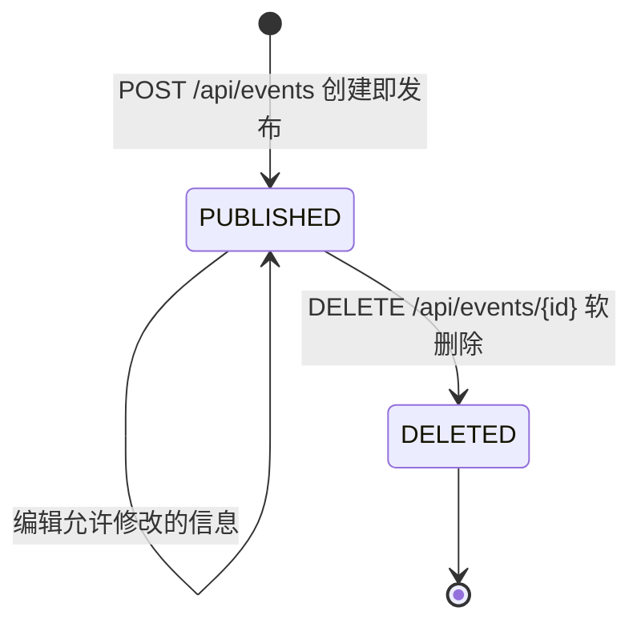
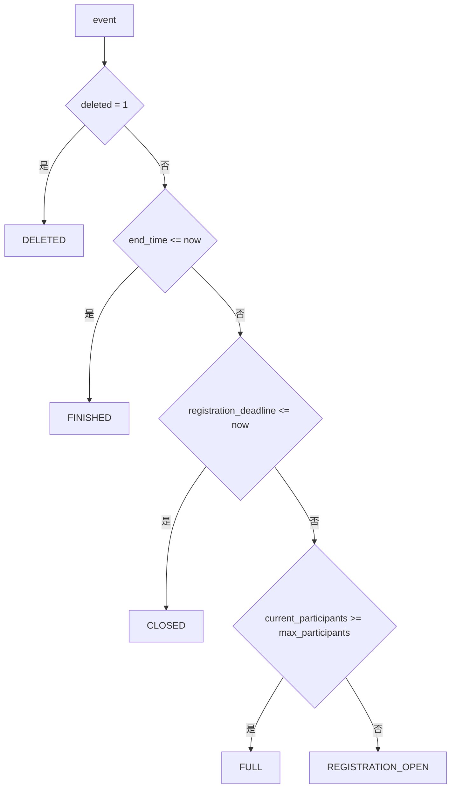
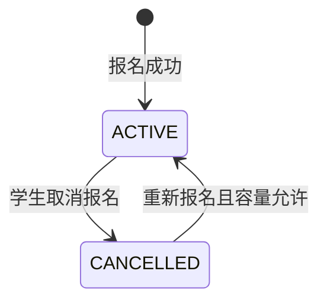
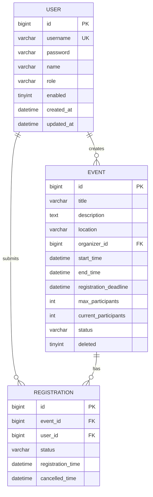
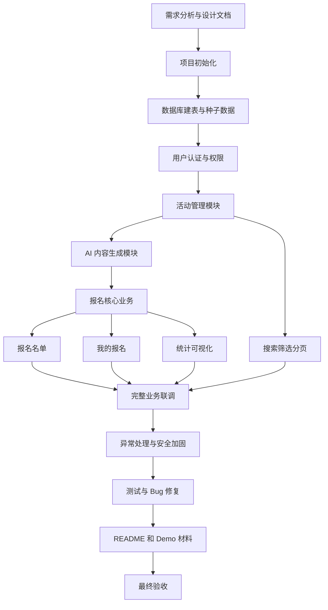

# 校园活动报名系统开发设计文档

## 1. 项目概述

校园活动报名系统面向校园讲座、社团活动、竞赛、志愿活动等常见场景，提供从活动发布、学生浏览、学生报名、人数控制、报名名单查看、取消报名、名额恢复到数据统计的完整业务闭环。

本项目的核心目标不是做一个静态展示页面，而是做一个可以真实启动、真实操作、真实保存数据、真实验证业务规则的课程综合实践系统。所有关键业务数据必须来自数据库，所有关键业务规则必须由后端和数据库共同保证，前端负责友好交互与即时反馈。

## 2. 需求分析

### 2.1 核心业务闭环

```text
组织者创建活动并填写基础信息
↓
AI 生成活动介绍和宣传文案
↓
组织者审核、修改并确认 AI 内容
↓
活动发布
↓
学生浏览活动列表
↓
学生查看活动详情
↓
学生报名
↓
报名数据入库
↓
活动报名人数增加
↓
剩余名额减少
↓
组织者查看报名名单
↓
统计图表同步变化
↓
满员后系统阻止继续报名
↓
学生取消报名
↓
报名状态变为已取消
↓
活动名额恢复
↓
其他学生可以继续报名
↓
活动结束后形成最终统计
```

### 2.2 必做功能

| 功能域 | 必做功能 |
| --- | --- |
| 用户与认证 | 注册、登录、查看当前用户、角色权限控制 |
| 活动管理 | 发布活动、编辑活动、删除活动、活动列表、活动详情 |
| 活动查询 | 按状态筛选、按关键词搜索、分页查询 |
| 报名业务 | 学生报名、取消报名、防重复报名、满员控制、名额恢复 |
| 名单管理 | 查看报名名单、报名人数、报名时间、报名状态 |
| 统计可视化 | 活动总数、报名总人数、报名率、状态分布、剩余名额 |
| AI 内容生成 | AI 自动生成活动介绍、AI 自动生成活动宣传文案、失败降级为手工填写 |
| 异常处理 | 非法输入、重复操作、满员报名、越权访问、Token 失效 |

## 3. 验收标准分析

老师提供的统一要求包括：项目可正常启动；完成题目规定核心功能；关键业务规则真实生效；关键业务数据能够保存；前后端形成完整数据闭环；对典型非法输入、重复操作、越界操作有基本异常处理；提交 README、启动说明、核心功能说明、AI 使用情况和演示视频。

本项目专项验收要求如下：

| 验收项 | 系统设计响应 |
| --- | --- |
| 活动发布、编辑、删除 | 管理端活动管理页 + Event API + event 表 |
| 活动列表与详情查看 | 活动大厅、活动详情页 + 分页查询 API |
| 学生报名与取消报名 | Registration Service 事务处理 + registration 表 |
| 报名名单查看 | 组织者名单页 + 报名列表 API |
| 按状态或关键词查询 | 后端分页查询 + title、description、location 检索 |
| 报名人数、剩余名额展示 | event.current_participants + max_participants 计算 |
| 报名率或状态分布 | Statistics API + ECharts |
| 不重复报名 | registration 表唯一约束 + Service 判断 |
| 满员不能报名 | MySQL 事务 + 条件 UPDATE + 唯一约束 |
| 取消恢复名额 | 事务内取消报名并减少 current_participants |
| AI 活动介绍生成 | EventForm AI 生成区 + AI API + AiService + 大模型 API |
| 异常明确提示 | 统一响应格式 + GlobalExceptionHandler + 前端 message |

## 4. 产品定位

系统定位为轻量级校园活动报名平台，主要服务课程验收和现场演示。它应当具备清晰的信息架构、稳定的数据流、可验证的业务规则和适度的可视化效果。

本系统优先保证 P0 核心闭环，不追求复杂中间件和大型企业架构。AI 活动介绍生成和 AI 宣传文案生成进入 P0 范围，作为活动创建流程中的核心辅助能力；活动报名、取消、人数控制、名单和统计不依赖 AI，即使 AI 服务失败，组织者也可以手工填写内容并完成活动发布。

## 5. 用户角色

### 5.1 角色结论

本项目建议设置 3 类角色，但实际权限保持简洁：

| 角色 | 说明 | 是否必需 | 权限边界 |
| --- | --- | --- | --- |
| 学生 STUDENT | 活动参与者 | 必需 | 浏览、搜索、查看详情、报名、取消、查看自己的报名 |
| 组织者 ORGANIZER | 活动发布者 | 必需 | 创建、编辑、删除自己创建的活动，查看自己活动的报名名单与统计 |
| 管理员 ADMIN | 系统管理者和演示兜底账号 | 建议 | 管理所有活动，查看全局统计，处理演示数据 |

### 5.2 不增加更多角色的原因

课程项目的核心是活动报名闭环，过多角色会增加权限复杂度和测试成本。组织者与管理员已经能覆盖活动维护与演示管理需求，学生覆盖报名需求。

## 6. 功能需求

### 6.1 学生端功能

- 注册和登录。
- 浏览活动大厅。
- 按关键词搜索活动，关键词覆盖标题、介绍、地点。
- 按状态筛选活动。
- 查看活动详情，包括时间、地点、名额、剩余名额、状态。
- 对允许报名的活动进行报名。
- 对已报名活动取消报名。
- 查看“我的报名”列表。
- 接收重复报名、满员、截止、结束、未登录等明确提示。

### 6.2 组织者端功能

- 登录组织者账号。
- 创建活动并发布。
- 编辑自己创建的活动。
- 删除未开始且无有效报名的活动，或者进行软删除。
- 查看自己创建的活动列表。
- 查看单个活动报名名单。
- 查看活动报名人数、剩余名额、报名率。
- 查看统计图表。

### 6.3 管理员功能

- 查看和管理所有活动。
- 查看全局统计。
- 在演示前维护示例账号与示例数据。

## 7. 非功能需求

| 类别 | 要求 |
| --- | --- |
| 可运行性 | 前端、后端、数据库均可本地启动，README 提供清晰步骤 |
| 可维护性 | 前后端目录清晰，Controller、Service、Mapper 分层明确 |
| 一致性 | 报名人数、剩余名额、报名记录状态保持一致 |
| 安全性 | 密码加密存储，接口鉴权，角色授权，参数校验 |
| 易演示 | 5 到 10 分钟可展示完整闭环，有固定 Demo 账号 |
| 可测试 | 单元测试、接口测试、验收测试用例覆盖核心规则 |
| 可扩展 | AI 内容生成模块独立实现，失败时降级为手工填写，不影响报名核心业务 |

## 8. 技术选型

### 8.1 推荐最终技术栈

| 层级 | 技术栈 |
| --- | --- |
| 前端 | Vue 3 + TypeScript + Vite + Element Plus + Vue Router + Pinia + Axios + ECharts |
| 后端 | Java 17 + Spring Boot 3.x + Maven + Spring Web + Spring Validation + Spring Security + JWT + MyBatis-Plus + Lombok |
| 数据库 | MySQL 8.x |
| 测试 | JUnit 5 + Spring Boot Test + MockMvc + Postman 或 Apifox |
| 工程工具 | Git + Maven + pnpm + ESLint + Prettier |
| 可选部署 | Docker Compose 管理 MySQL、后端、前端 |

### 8.2 选择原因

Vue 3、Vite 和 Element Plus 适合快速构建课程项目界面，组件成熟，表单、表格、分页、弹窗和提示能力完整。TypeScript 可以减少接口字段错用。Pinia 管理登录用户与 Token 状态，Axios 封装统一请求响应，ECharts 满足统计可视化验收。

Spring Boot 3 和 Java 17 稳定、课程认可度高，适合表达企业级分层架构。MyBatis-Plus 对 CRUD、分页、条件查询支持直接，代码量比纯 MyBatis 少，也比 JPA 更容易直观看到 SQL 和表结构映射。Spring Validation 支撑参数校验，Spring Security + JWT 支撑登录和角色权限。

MySQL 8 是课程项目中最稳妥的关系型数据库，能够通过唯一索引、外键、事务和条件 UPDATE 保证关键业务规则，避免引入 Redis、分布式锁或消息队列。

### 8.3 不建议加入的技术

| 技术 | 结论 | 原因 |
| --- | --- | --- |
| Redis | P0 不加入 | 报名并发可由 MySQL 事务解决，缓存会增加一致性成本 |
| 微服务 | 不加入 | 项目规模小，单体架构更稳定、易验收 |
| Kubernetes | 不加入 | 部署复杂度远高于课程项目收益 |
| 消息队列 | 不加入 | 报名和统计均可同步完成 |
| 分布式锁 | 不加入 | 单库事务和条件更新已能防止名额超卖 |

## 9. 系统总体架构

```text
用户浏览器
  ↓
Vue 3 前端 Web
  ↓ Axios / HTTP / JSON
Spring Boot REST API
  ↓
Controller 控制层
  ↓
DTO 参数校验 / 鉴权授权
  ↓
Service 业务服务层
  ↓
Mapper 数据访问层
  ↓
MySQL 8 数据库
```

### 9.1 职责划分

| 部分 | 职责 |
| --- | --- |
| 前端 | 页面展示、表单校验、登录状态保存、调用 API、错误提示、图表渲染 |
| 后端 | 鉴权、权限控制、业务规则校验、事务处理、统一异常、统计聚合 |
| 数据库 | 持久化用户、活动、报名记录，提供索引、唯一约束和事务支持 |
| JWT | 登录后签发 Token，前端请求时携带，后端解析用户身份和角色 |
| 日志系统 | 记录登录、活动变更、报名、取消报名和异常信息 |
| AI 模块 | 活动创建流程的 P0 模块，负责生成活动介绍和宣传文案，失败时允许手工填写 |

### 9.2 核心规则执行位置

| 规则 | 前端 | 后端 | 数据库 |
| --- | --- | --- | --- |
| 必填字段 | 即时提示 | Spring Validation | NOT NULL |
| 不重复报名 | 按钮状态提示 | Service 判断 | 唯一索引 |
| 满员禁止报名 | 禁用按钮 | MySQL 事务 + 条件 UPDATE | current_participants 约束和唯一索引 |
| 取消恢复名额 | 刷新展示 | Service 事务更新 | 数据一致性约束 |
| 权限控制 | 菜单隐藏 | Spring Security | 数据归属过滤 |

## 10. 工程目录结构

```text
campus_event_registration_system/
├── backend/
│   ├── pom.xml
│   ├── src/
│   │   ├── main/
│   │   │   ├── java/com/example/campusevent/
│   │   │   │   ├── CampusEventApplication.java
│   │   │   │   ├── common/
│   │   │   │   │   ├── api/
│   │   │   │   │   │   ├── ApiResponse.java
│   │   │   │   │   │   ├── PageResponse.java
│   │   │   │   │   │   └── ErrorCode.java
│   │   │   │   │   ├── exception/
│   │   │   │   │   │   ├── BusinessException.java
│   │   │   │   │   │   └── GlobalExceptionHandler.java
│   │   │   │   │   ├── security/
│   │   │   │   │   │   ├── JwtAuthenticationFilter.java
│   │   │   │   │   │   ├── JwtTokenProvider.java
│   │   │   │   │   │   └── SecurityConfig.java
│   │   │   │   │   └── util/
│   │   │   │   │       ├── DateTimeUtils.java
│   │   │   │   │       └── CurrentUserUtils.java
│   │   │   │   ├── user/
│   │   │   │   │   ├── controller/UserController.java
│   │   │   │   │   ├── controller/AuthController.java
│   │   │   │   │   ├── service/UserService.java
│   │   │   │   │   ├── service/impl/UserServiceImpl.java
│   │   │   │   │   ├── mapper/UserMapper.java
│   │   │   │   │   ├── entity/User.java
│   │   │   │   │   ├── dto/LoginRequest.java
│   │   │   │   │   ├── dto/RegisterRequest.java
│   │   │   │   │   └── vo/UserVO.java
│   │   │   │   ├── event/
│   │   │   │   │   ├── controller/EventController.java
│   │   │   │   │   ├── service/EventService.java
│   │   │   │   │   ├── service/impl/EventServiceImpl.java
│   │   │   │   │   ├── mapper/EventMapper.java
│   │   │   │   │   ├── entity/Event.java
│   │   │   │   │   ├── dto/EventCreateRequest.java
│   │   │   │   │   ├── dto/EventUpdateRequest.java
│   │   │   │   │   ├── dto/EventQueryRequest.java
│   │   │   │   │   └── vo/EventVO.java
│   │   │   │   ├── registration/
│   │   │   │   │   ├── controller/RegistrationController.java
│   │   │   │   │   ├── service/RegistrationService.java
│   │   │   │   │   ├── service/impl/RegistrationServiceImpl.java
│   │   │   │   │   ├── mapper/RegistrationMapper.java
│   │   │   │   │   ├── entity/Registration.java
│   │   │   │   │   └── vo/RegistrationVO.java
│   │   │   │   ├── statistics/
│   │   │   │   │   ├── controller/StatisticsController.java
│   │   │   │   │   ├── service/StatisticsService.java
│   │   │   │   │   ├── service/impl/StatisticsServiceImpl.java
│   │   │   │   │   └── vo/StatisticsVO.java
│   │   │   │   └── ai/
│   │   │   │       ├── controller/AiController.java
│   │   │   │       ├── service/AiService.java
│   │   │   │       ├── service/impl/AiServiceImpl.java
│   │   │   │       ├── client/AiModelClient.java
│   │   │   │       ├── dto/EventIntroductionRequest.java
│   │   │   │       ├── dto/EventPromotionRequest.java
│   │   │   │       └── vo/AiGenerateVO.java
│   │   │   └── resources/
│   │   │       ├── application.yml
│   │   │       ├── application-dev.yml
│   │   │       ├── application-prod.yml
│   │   │       └── mapper/
│   │   │           ├── EventMapper.xml
│   │   │           ├── RegistrationMapper.xml
│   │   │           └── StatisticsMapper.xml
│   │   └── test/java/com/example/campusevent/
│   │       ├── event/EventServiceTest.java
│   │       ├── registration/RegistrationServiceTest.java
│   │       └── api/EventApiTest.java
│   └── README.md
│
├── frontend/
│   ├── package.json
│   ├── vite.config.ts
│   ├── tsconfig.json
│   ├── .eslintrc.cjs
│   ├── .prettierrc
│   └── src/
│       ├── main.ts
│       ├── App.vue
│       ├── api/
│       │   ├── request.ts
│       │   ├── auth.ts
│       │   ├── event.ts
│       │   ├── registration.ts
│       │   ├── ai.ts
│       │   └── statistics.ts
│       ├── assets/
│       ├── components/
│       │   ├── AiGenerateButton.vue
│       │   ├── EventCard.vue
│       │   ├── StatusTag.vue
│       │   ├── PageHeader.vue
│       │   └── EmptyState.vue
│       ├── layouts/
│       │   └── MainLayout.vue
│       ├── router/
│       │   └── index.ts
│       ├── stores/
│       │   ├── auth.ts
│       │   └── event.ts
│       ├── types/
│       │   ├── api.ts
│       │   ├── event.ts
│       │   └── registration.ts
│       ├── utils/
│       │   ├── auth.ts
│       │   ├── date.ts
│       │   └── status.ts
│       └── views/
│           ├── LoginView.vue
│           ├── RegisterView.vue
│           ├── EventHallView.vue
│           ├── EventDetailView.vue
│           ├── MyRegistrationsView.vue
│           ├── ManageEventsView.vue
│           ├── EventFormView.vue
│           ├── RegistrationListView.vue
│           └── StatisticsView.vue
│
├── database/
│   ├── schema.sql
│   ├── seed.sql
│   └── reset.sql
│
├── docs/
│   ├── 校园活动报名系统开发设计文档.md
│   ├── api-design.md
│   ├── test-report.md
│   └── demo-script.md
│
├── screenshots/
├── README.md
└── docker-compose.yml
```

### 10.1 目录说明

| 目录 | 作用 |
| --- | --- |
| backend | Spring Boot 后端工程，负责 API、业务规则、数据库访问 |
| frontend | Vue 前端工程，负责页面、交互、图表和接口调用 |
| database | 建表 SQL、初始化数据、重置脚本 |
| docs | 设计文档、接口文档、测试报告、演示脚本 |
| screenshots | README 和验收材料中的项目截图 |
| docker-compose.yml | 可选的一键启动 MySQL 等服务 |

## 11. 系统模块划分

| 模块 | 后端包 | 前端页面 | 核心职责 |
| --- | --- | --- | --- |
| 用户认证 | user、common.security | LoginView、RegisterView | 注册、登录、JWT、当前用户 |
| 活动管理 | event | ManageEventsView、EventFormView | 活动增删改查、状态维护 |
| 活动浏览 | event | EventHallView、EventDetailView | 列表、详情、搜索、筛选 |
| 活动报名 | registration | EventDetailView、MyRegistrationsView | 报名、取消、防重复、满员控制 |
| 报名名单 | registration | RegistrationListView | 查看学生名单和报名状态 |
| 统计分析 | statistics | StatisticsView | 概览指标、状态分布、报名率图表 |
| 异常处理 | common.exception | request.ts 全局拦截 | 统一错误码和提示 |
| AI 内容生成 | ai | EventFormView、AiGenerateButton | 生成活动介绍和宣传文案，组织者确认后写入活动内容 |

## 12. 用户模块设计

### 12.1 功能

- 用户注册：普通注册只创建学生账号，注册请求只接收 username、password、name，后端强制 role = STUDENT。
- 组织者和管理员账号：通过 seed.sql 初始化。本项目不实现管理员创建用户功能，不提供创建组织者账号的后台页面或用户管理 API。
- 用户登录：校验用户名和密码，返回 JWT 和用户信息。
- 当前用户：根据 Token 查询当前登录用户。
- 权限控制：基于角色限制接口访问。

### 12.2 核心规则

| 规则 | 实现方式 |
| --- | --- |
| 用户名唯一 | user.username 唯一索引 |
| 密码不能明文 | BCryptPasswordEncoder 加密 |
| 未登录不能报名 | Spring Security 拦截 |
| 学生不能删除活动 | 方法级角色校验 + 数据归属判断 |
| 普通注册不能提升角色 | RegisterRequest 不包含 role，后端忽略外部 role 参数并固定 STUDENT |

## 13. 活动模块设计

### 13.1 活动字段

活动包含标题、介绍、地点、组织者 ID、开始时间、结束时间、报名截止时间、人数上限、当前报名人数、基础状态、软删除标记等字段。组织者名称不在 event 表冗余保存，活动详情和列表通过 user 表关联查询获得。

### 13.2 活动操作

| 操作 | 权限 | 主要校验 |
| --- | --- | --- |
| 创建活动 | ORGANIZER、ADMIN | 标题非空，人数上限大于 0，时间合法 |
| 编辑活动 | 创建者或 ADMIN | 活动存在，未删除，未结束，有权限，时间合法，人数上限不得小于当前有效报名人数 |
| 删除活动 | 创建者或 ADMIN | 活动存在，有权限；有报名时优先软删除 |
| 查询列表 | 已登录用户 | 支持关键词、状态、分页 |
| 查询详情 | 已登录用户 | 活动存在且未删除 |

### 13.3 状态计算原则

数据库 `event.status` 只保存 `PUBLISHED`。本项目不实现草稿保存和单独取消活动功能；活动创建成功后直接发布，删除/取消统一通过 `deleted = 1` 软删除表达。后端在查询活动列表、详情、统计时，根据 `status`、`deleted`、当前时间、`registration_deadline`、`end_time`、`current_participants`、`max_participants` 计算 `displayStatus`，前端只展示 `displayStatus`。

### 13.4 活动编辑边界

| 规则 | 处理方式 | 提示 |
| --- | --- | --- |
| 人数上限不得小于当前 ACTIVE 报名人数 | EventService 查询 current_participants 后校验 | 人数上限不能小于当前报名人数 |
| 已有 ACTIVE 报名后禁止修改核心时间 | 只要 current_participants > 0，就不允许修改 start_time、end_time、registration_deadline | 已有学生报名，不能修改活动时间 |
| 活动结束后不能编辑核心信息 | displayStatus = FINISHED 时禁止编辑标题、介绍、地点、时间、人数上限 | 活动已结束，不能编辑核心信息 |
| 已删除活动不能普通编辑 | deleted = 1 时拒绝 | 活动已删除，不能编辑 |
| 组织者只能编辑自己的活动 | organizer_id 必须等于当前用户 id | 无权限操作该活动 |
| ADMIN 可以管理全部活动 | ADMIN 跳过归属限制，但仍需业务校验 | 按业务规则返回 |

## 14. 报名模块设计

### 14.1 报名原则

- 报名必须登录。
- 只有学生可以报名。
- 同一学生同一活动同一时间只能有一条有效报名。
- 只有 `status = PUBLISHED`、`deleted = 0`、未截止、未结束、未满员的活动可以报名。
- 取消报名后报名记录保留，状态变为 CANCELLED，名额恢复。
- 只有 ACTIVE 报名可以取消，活动结束后不能取消。
- 取消后重新报名允许，但必须重新走容量校验；重新报名时 status = ACTIVE，registration_time = NOW()，cancelled_time = NULL。

### 14.2 报名流程

```text
学生点击报名
↓
前端检查登录状态和按钮状态
↓
POST /api/events/{id}/registrations
↓
Controller 获取当前用户
↓
Service 开启事务
↓
检查活动是否存在且未删除
↓
检查活动是否允许报名
↓
检查是否已有 ACTIVE 报名
↓
执行活动人数条件更新 current_participants = current_participants + 1
↓
如果更新行数为 0，说明活动不是 PUBLISHED、已删除、已满员、已截止或已结束
↓
插入或恢复报名记录为 ACTIVE，并将 cancelled_time 置为 NULL
↓
提交事务
↓
返回报名成功和最新活动信息
↓
前端刷新详情、列表、我的报名、统计
```

### 14.3 取消流程

```text
学生点击取消报名
↓
DELETE /api/events/{id}/registrations/me
↓
Service 开启事务
↓
检查活动存在、未删除、未结束
↓
原子更新报名记录：
UPDATE registration
SET status = 'CANCELLED',
    cancelled_time = NOW(),
    updated_at = NOW()
WHERE event_id = ?
  AND user_id = ?
  AND status = 'ACTIVE'
↓
如果影响行数 = 0，返回“当前没有有效报名”
↓
如果影响行数 = 1，继续更新活动人数
↓
UPDATE event
SET current_participants = current_participants - 1
WHERE id = ?
  AND current_participants > 0
↓
后端重新计算 displayStatus，若未截止且未结束则可从 FULL 回到 REGISTRATION_OPEN
↓
提交事务
↓
前端刷新人数和按钮状态
```

## 15. 名单模块设计

报名名单用于组织者或管理员查看某个活动的报名学生。默认展示 ACTIVE 报名记录，可通过状态筛选查看已取消记录。

| 字段 | 说明 |
| --- | --- |
| 学生姓名 | user.name |
| 账号/用户名 | user.username |
| 报名时间 | registration.registration_time |
| 报名状态 | ACTIVE、CANCELLED |
| 取消时间 | registration.cancelled_time |

权限规则：学生不能查看全部报名名单；组织者只能查看自己活动的名单；管理员可查看所有名单。

## 16. 统计模块设计

### 16.1 首页概览

| 指标 | 公式或来源 |
| --- | --- |
| 活动总数 | event 未删除记录数 |
| 报名总人数 | registration 中 ACTIVE 记录数 |
| 报名中活动数量 | displayStatus = REGISTRATION_OPEN 的活动数量 |
| 已结束活动数量 | end_time < 当前时间的活动数量 |

### 16.2 活动统计

| 指标 | 公式 |
| --- | --- |
| 当前报名人数 | event.current_participants |
| 剩余名额 | max_participants - current_participants |
| 报名率 | current_participants / max_participants * 100% |
| 状态分布 | 按 displayStatus 聚合 |

统计数据实时查询，不单独保存统计表。课程项目数据量小，实时聚合足够稳定。

## 17. AI 内容生成设计

AI 智能活动内容生成是 P0 核心功能，必须进入活动创建流程。至少实现两项能力：AI 自动生成活动介绍、AI 自动生成活动宣传文案。活动智能问答不进入 P0 范围，放入后续增强。

### 17.1 P0 AI 功能

| 功能 | 入口 | 权限 | 输出 | 是否保存 |
| --- | --- | --- | --- | --- |
| AI 自动生成活动介绍 | EventFormView 的 AI 生成区 | ORGANIZER、ADMIN | introduction、highlights、audience | 组织者确认后写入 event.description |
| AI 自动生成宣传文案 | EventFormView 的 AI 生成区 | ORGANIZER、ADMIN | promotion、highlights、audience | 仅在前端展示并支持复制，不单独保存到数据库 |

### 17.2 AI 主流程

```text
组织者填写活动标题、地点、时间、人数、活动类型等基础信息
↓
点击“AI 生成活动介绍”或“AI 生成宣传文案”
↓
前端 POST /api/ai/event-introduction 或 /api/ai/event-promotion
↓
后端校验权限和参数
↓
AiService 调用 AiModelClient
↓
AiModelClient 从环境变量读取 API Key 并调用真实大模型 API
↓
后端解析模型结果并返回 AiGenerateVO
↓
前端展示 AI 生成内容
↓
组织者审核、修改、确认
↓
AI 活动介绍写入活动介绍表单字段，AI 宣传文案在前端展示并支持复制
↓
保存活动时仅将组织者确认后的活动介绍写入 event.description
```

AI 输出不是最终活动数据。AI 活动介绍只有经过组织者审核、修改、确认并保存活动后，最终文本才进入 `event.description`。AI 宣传文案不增加数据库字段，不写入 event 表，只作为前端展示和复制内容。AI 调用失败时，前端提示失败原因并允许手工填写，活动创建仍可继续。

### 17.3 AI 配置与降级

| 原则 | 设计 |
| --- | --- |
| 真实调用 | 正式 Demo 使用真实大模型 API，不使用固定写死返回值 |
| 失败降级 | AI 接口失败时活动创建仍可手工填写 |
| 独立配置 | API Key 放在环境变量或本地未提交配置，不提交 Git，不暴露给前端 |
| 独立模块 | ai 包单独存在，不与 EventService 强耦合 |
| 超时控制 | AiModelClient 设置连接和响应超时，超时返回明确业务错误 |
| Mock 模式 | 仅用于本地开发和自动化测试，正式演示必须关闭 Mock 并使用真实 AI 调用 |

## 18. 活动状态机

### 18.1 状态定义

数据库字段 `event.status` 只保存 `PUBLISHED`。活动创建成功后直接发布；删除/取消活动统一通过软删除字段 `deleted = 1` 表达，不再设计 `DRAFT` 或活动级 `CANCELLED`。

| 数据字段 | 取值 | 含义 |
| --- | --- | --- |
| status | PUBLISHED | 已发布活动，展示状态由后端继续计算 |
| deleted | 0 | 正常活动 |
| deleted | 1 | 已删除/取消活动，普通用户不可见、不可报名、不可编辑 |

后端返回给前端的 `displayStatus` 包括：

| displayStatus | 含义 | 是否可报名 | 计算规则 |
| --- | --- | --- | --- |
| REGISTRATION_OPEN | 报名中 | 是 | status = PUBLISHED 且 deleted = 0 且未截止且未结束且未满员 |
| FULL | 已满员 | 否 | status = PUBLISHED 且 deleted = 0 且 current_participants >= max_participants 且未截止且未结束 |
| CLOSED | 报名截止 | 否 | status = PUBLISHED 且 deleted = 0 且 registration_deadline <= 当前时间 且未结束 |
| FINISHED | 活动结束 | 否 | status = PUBLISHED 且 deleted = 0 且 end_time <= 当前时间 |
| DELETED | 已删除 | 否 | deleted = 1 |

### 18.2 状态迁移图



展示状态由后端运行时计算，不写入数据库：



### 18.3 状态规则

- 满员不等于报名截止。满员是容量状态，截止是时间状态。
- 满员后如果有人取消，且未到报名截止时间，活动可重新显示为报名中。
- 报名截止后即使有人取消，也不能重新报名。
- 活动结束后不能报名、取消报名或编辑核心时间信息。
- 删除活动采用软删除，`deleted = 1` 后普通活动列表不展示，普通详情接口不可访问，禁止报名、取消报名和编辑，历史 registration 不删除。
- 普通统计不统计 deleted = 1 的活动；管理员历史数据查看可作为管理能力的一部分，不进入 P0 统计口径。
- 前端状态标签只使用 `displayStatus`，不直接解释数据库 `status`。

## 19. 报名状态机

| 状态 | 含义 | 可进入方式 |
| --- | --- | --- |
| ACTIVE | 有效报名 | 学生成功报名 |
| CANCELLED | 已取消 | 学生主动取消报名 |



最终实现固定为：同一用户和同一活动只保留一条报名记录。首次报名插入记录；取消时用 `WHERE status = 'ACTIVE'` 原子更新为 CANCELLED；重新报名时将同一条记录恢复为 ACTIVE，并更新 registration_time、清空 cancelled_time。该方案与 `uk_registration_event_user(event_id, user_id)` 唯一约束保持一致。

## 20. 核心业务流程

### 20.1 发布活动

```text
组织者打开活动表单
↓
填写标题、介绍、地点、时间、人数上限
↓
如需辅助，点击 AI 生成活动介绍或宣传文案
↓
组织者审核并修改 AI 生成内容
↓
前端 Element Plus 表单校验
↓
POST /api/events
↓
Controller 接收 EventCreateRequest
↓
Spring Validation 校验字段
↓
EventService 校验时间和权限
↓
EventMapper 插入 event
↓
返回 EventVO
↓
前端跳转活动管理页并刷新列表
```

### 20.2 搜索活动

```text
用户输入关键词或选择状态
↓
前端更新查询参数 page、pageSize、keyword、status
↓
GET /api/events
↓
后端按 title、description、location 模糊查询
↓
后端使用 CASE WHEN 计算 displayStatus 并按 displayStatus 过滤
↓
返回分页结果
↓
前端刷新活动卡片和分页器
```

### 20.3 报名和取消

报名和取消流程见第 14 节，必须在事务中完成报名记录和 current_participants 的同步更新。

### 20.4 完整业务闭环节点映射

| 闭环节点 | 前端页面 | API | 涉及表 | 数据变化 |
| --- | --- | --- | --- | --- |
| 组织者创建活动 | 活动表单页 | POST /api/events | event | 新增活动，current_participants = 0 |
| AI 生成介绍 | 活动表单页 | POST /api/ai/event-introduction | 无直接写库 | 返回 AI 内容，等待组织者确认 |
| AI 生成宣传文案 | 活动表单页 | POST /api/ai/event-promotion | 无直接写库 | 返回 AI 内容，等待组织者确认 |
| 活动发布 | 活动表单页 | POST /api/events | event | status = PUBLISHED，description 保存组织者确认后的活动介绍 |
| 学生浏览活动 | 活动大厅 | GET /api/events | event | 无数据变化 |
| 查看详情 | 活动详情页 | GET /api/events/{id} | event、registration | 返回当前用户是否已报名 |
| 学生报名 | 活动详情页 | POST /api/events/{id}/registrations | event、registration | 报名状态 ACTIVE，人数 +1 |
| 人数增加 | 活动详情页、活动大厅 | POST 报名接口返回后刷新 | event | current_participants 增加 |
| 剩余名额减少 | 活动详情页、活动大厅 | GET /api/events/{id} | event | 前端计算 max - current |
| 名单更新 | 报名名单页 | GET /api/events/{id}/registrations | registration、user | 出现新增学生 |
| 统计更新 | 统计页 | GET /api/statistics/* | event、registration | 图表按最新数据计算 |
| 达到上限 | 活动详情页 | POST 报名接口 | event | current_participants = max_participants |
| 阻止继续报名 | 活动详情页 | POST 报名接口 | event、registration | 不插入报名，返回满员错误 |
| 学生取消报名 | 我的报名、活动详情 | DELETE /api/events/{id}/registrations/me | event、registration | ACTIVE 报名原子更新为 CANCELLED，人数 -1 |
| 名额恢复 | 活动大厅、详情页 | GET /api/events/{id} | event | 剩余名额增加 |
| 其他学生继续报名 | 活动详情页 | POST /api/events/{id}/registrations | event、registration | 新学生报名成功 |
| 活动结束 | 活动大厅、统计页 | GET /api/events、GET /statistics | event | 计算状态显示 FINISHED |
| 最终统计 | 统计页 | GET /api/statistics/overview | event、registration | 展示最终指标 |

### 20.5 关键业务规则汇总表

| 编号 | 业务规则 | 实现位置 | 验证方式 |
| --- | --- | --- | --- |
| BR-001 | 同一用户不能重复报名同一活动 | registration 唯一约束 + RegistrationService | 同一学生重复点击报名 |
| BR-002 | 活动满员后不能继续报名 | RegistrationService 条件 UPDATE | 将活动报名至上限后再报名 |
| BR-003 | 取消报名后名额必须恢复 | RegistrationService 事务 | 取消后查看剩余名额 |
| BR-004 | 取消后允许重新报名 | RegistrationService 状态恢复 | 取消后再次点击报名 |
| BR-005 | 报名截止后不能报名 | RegistrationService 时间校验 | 设置截止时间为过去 |
| BR-006 | 活动结束后不能报名 | RegistrationService 时间校验 | 设置 end_time 为过去 |
| BR-007 | 已删除活动不能报名、不能查看普通详情、不能编辑、不能取消报名 | EventService + RegistrationService | 删除后访问详情、报名、取消和编辑接口 |
| BR-008 | 普通学生不能创建、编辑、删除活动 | Spring Security + Service 权限校验 | 学生调用管理接口 |
| BR-009 | 普通学生不能查看全部报名名单 | RegistrationService 权限校验 | 学生访问名单接口 |
| BR-010 | 组织者只能管理自己创建的活动 | EventService 归属校验 | 组织者编辑他人活动 |
| BR-011 | 活动标题不能为空 | DTO Validation + DB NOT NULL | 空标题提交 |
| BR-012 | 人数上限必须大于 0 | DTO Validation + Service + DB CHECK | 上限为 0 或负数 |
| BR-013 | 报名截止时间必须早于活动开始时间 | EventService | 提交非法时间 |
| BR-014 | 活动结束时间必须晚于开始时间 | EventService | 提交非法时间 |
| BR-015 | 报名人数不能超过人数上限 | 条件 UPDATE + 事务 | 并发报名最后一个名额 |
| BR-016 | 当前报名人数不能小于 0 | 取消报名原子 UPDATE + event current_participants > 0 条件 | 重复取消报名 |
| BR-017 | 统计数据必须来自真实数据库 | StatisticsService | 报名后刷新统计页 |
| BR-018 | 所有业务异常必须有明确提示 | GlobalExceptionHandler + Axios 拦截器 | 非法输入、重复操作、满员操作 |
| BR-019 | 密码不能明文保存 | BCryptPasswordEncoder | 查看 user 表 password 字段 |
| BR-020 | 普通注册不能指定角色 | RegisterRequest + UserService | 提交 role=ADMIN 后仍注册为 STUDENT |
| BR-021 | 编辑人数上限不得小于当前报名人数 | EventService | 当前 3 人报名时把上限改为 2 |
| BR-022 | 活动结束后不能编辑核心信息 | EventService | 结束后编辑标题、时间或人数 |
| BR-023 | 已删除活动不能普通编辑 | EventService | 删除后调用编辑接口 |
| BR-024 | AI 活动介绍生成必须真实调用后端 API | AiController + AiService | EventForm 点击 AI 生成活动介绍 |
| BR-025 | AI 宣传文案生成必须真实调用后端 API | AiController + AiService | EventForm 点击 AI 生成宣传文案 |
| BR-026 | AI 失败必须可降级为手工填写 | AiService + 前端异常提示 | API Key 缺失或模型超时 |
| BR-027 | 学生不能调用 AI 生成接口 | Spring Security | STUDENT 调用 /api/ai/* 返回 403 |

## 21. 数据库设计

### 21.1 user 表

| 字段 | 类型 | NULL | 默认值 | 说明 | 约束 |
| --- | --- | --- | --- | --- | --- |
| id | BIGINT | NO | AUTO_INCREMENT | 用户 ID | PK |
| username | VARCHAR(50) | NO | 无 | 登录账号，可作为课程演示中的用户名 | UNIQUE |
| password | VARCHAR(100) | NO | 无 | BCrypt 密码哈希 |  |
| name | VARCHAR(50) | NO | 无 | 姓名 |  |
| role | VARCHAR(20) | NO | STUDENT | STUDENT、ORGANIZER、ADMIN | INDEX |
| enabled | TINYINT | NO | 1 | 是否启用 |  |
| created_at | DATETIME | NO | CURRENT_TIMESTAMP | 创建时间 |  |
| updated_at | DATETIME | NO | CURRENT_TIMESTAMP | 更新时间 | ON UPDATE |

### 21.2 event 表

| 字段 | 类型 | NULL | 默认值 | 说明 | 约束 |
| --- | --- | --- | --- | --- | --- |
| id | BIGINT | NO | AUTO_INCREMENT | 活动 ID | PK |
| title | VARCHAR(100) | NO | 无 | 活动标题 | INDEX |
| description | TEXT | NO | 无 | 活动介绍 |  |
| location | VARCHAR(100) | NO | 无 | 活动地点 | INDEX |
| organizer_id | BIGINT | NO | 无 | 创建者用户 ID | FK user.id, INDEX |
| start_time | DATETIME | NO | 无 | 活动开始时间 | INDEX |
| end_time | DATETIME | NO | 无 | 活动结束时间 | INDEX |
| registration_deadline | DATETIME | NO | 无 | 报名截止时间 | INDEX |
| max_participants | INT | NO | 无 | 人数上限 | CHECK > 0 |
| current_participants | INT | NO | 0 | 当前有效报名人数 | CHECK >= 0 |
| status | VARCHAR(20) | NO | PUBLISHED | 固定为 PUBLISHED | INDEX |
| deleted | TINYINT | NO | 0 | 软删除标记 | INDEX |
| created_at | DATETIME | NO | CURRENT_TIMESTAMP | 创建时间 |  |
| updated_at | DATETIME | NO | CURRENT_TIMESTAMP | 更新时间 | ON UPDATE |

### 21.3 registration 表

| 字段 | 类型 | NULL | 默认值 | 说明 | 约束 |
| --- | --- | --- | --- | --- | --- |
| id | BIGINT | NO | AUTO_INCREMENT | 报名 ID | PK |
| event_id | BIGINT | NO | 无 | 活动 ID | FK event.id, INDEX |
| user_id | BIGINT | NO | 无 | 学生用户 ID | FK user.id, INDEX |
| status | VARCHAR(20) | NO | ACTIVE | ACTIVE、CANCELLED | INDEX |
| registration_time | DATETIME | NO | CURRENT_TIMESTAMP | 最近一次报名时间 |  |
| cancelled_time | DATETIME | YES | NULL | 最近一次取消时间 |  |
| created_at | DATETIME | NO | CURRENT_TIMESTAMP | 创建时间 |  |
| updated_at | DATETIME | NO | CURRENT_TIMESTAMP | 更新时间 | ON UPDATE |

唯一约束：`uk_registration_event_user(event_id, user_id)`。本项目采用同一活动同一用户只保留一条报名记录的方案，因此天然避免重复有效报名。取消后重新报名时更新同一条记录为 ACTIVE。

### 21.4 高频索引

| 表 | 索引 | 用途 |
| --- | --- | --- |
| user | uk_user_username | 登录查询、防重复注册 |
| event | idx_event_status_deleted | 基础状态和软删除过滤 |
| event | idx_event_time | 活动时间状态计算 |
| event | idx_event_keyword | 标题、地点检索 |
| registration | uk_registration_event_user | 防重复报名 |
| registration | idx_registration_user_status | 我的报名 |
| registration | idx_registration_event_status | 报名名单和人数校验 |

## 22. ER 图



用户与活动是一对多：一个组织者可以创建多个活动。用户与活动通过 registration 构成多对多：一个学生可报名多个活动，一个活动可有多个学生报名。

## 23. API 设计

统一前缀：`/api`。除注册、登录外，其他接口默认需要 JWT。

### 23.1 用户接口

| 方法 | URL | 权限 | 请求 | 成功响应 | 失败响应 | 数据库影响 |
| --- | --- | --- | --- | --- | --- | --- |
| POST | /api/auth/register | 匿名 | username、password、name | 用户信息，role 固定为 STUDENT | 用户名已存在、参数错误；外部 role 参数被忽略 | 插入 user |
| POST | /api/auth/login | 匿名 | username、password | token、user | 用户不存在、密码错误 | 无 |
| GET | /api/users/me | 登录 | 无 | 当前用户 | 未认证、Token 失效 | 无 |

### 23.2 活动接口

| 方法 | URL | 权限 | 请求参数或 Body | 成功响应 | 可能异常 | 数据库影响 |
| --- | --- | --- | --- | --- | --- | --- |
| GET | /api/events | 登录 | page、pageSize、keyword、status | 分页 EventVO | 参数错误 | 无 |
| GET | /api/events/{id} | 登录 | id | EventVO | 活动不存在、活动已删除；ADMIN 可访问历史详情 | 无 |
| POST | /api/events | ORGANIZER、ADMIN | EventCreateRequest | EventVO | 参数错误、时间非法 | 插入 event，status = PUBLISHED，deleted = 0 |
| PUT | /api/events/{id} | 创建者、ADMIN | EventUpdateRequest | EventVO | 无权限、活动不存在、活动已删除、活动已结束、人数上限非法 | 更新 event |
| DELETE | /api/events/{id} | 创建者、ADMIN | id | true | 无权限、活动不存在 | 软删除 event，deleted = 1 |

EventVO 必须包含：`id`、`title`、`description`、`location`、`organizerId`、`organizerName`、`startTime`、`endTime`、`registrationDeadline`、`maxParticipants`、`currentParticipants`、`remainingParticipants`、`registrationRate`、`status`、`displayStatus`、`registeredByCurrentUser`。其中 `organizerName` 来自 user 表关联查询，`displayStatus` 由后端计算，前端不自行推断。

### 23.3 报名接口

| 方法 | URL | 权限 | 请求 | 成功响应 | 失败响应 | 数据库影响 |
| --- | --- | --- | --- | --- | --- | --- |
| POST | /api/events/{id}/registrations | STUDENT | event id | 最新 EventVO 或 RegistrationVO | 重复报名、满员、截止、结束 | 更新 event，插入或更新 registration |
| DELETE | /api/events/{id}/registrations/me | STUDENT | event id | 最新 EventVO | 未报名、重复取消、活动已删除、活动已结束 | 原子更新 registration，更新 event |
| GET | /api/events/{id}/registrations | ORGANIZER、ADMIN | page、pageSize、status | 报名名单分页 | 无权限、活动不存在 | 无 |
| GET | /api/my/registrations | STUDENT | page、pageSize、status | 我的报名分页 | 未认证 | 无 |

### 23.4 统计接口

| 方法 | URL | 权限 | 请求 | 成功响应 | 数据来源 |
| --- | --- | --- | --- | --- | --- |
| GET | /api/statistics/overview | ORGANIZER、ADMIN | 无 | 总活动、总报名、报名中、已结束 | event、registration |
| GET | /api/statistics/events | ORGANIZER、ADMIN | eventId 可选 | 活动报名率、剩余名额 | event |
| GET | /api/statistics/status-distribution | ORGANIZER、ADMIN | 无 | 状态分布数组 | event 计算状态 |

### 23.5 AI 接口

| 方法 | URL | 权限 | 请求 Body | 成功响应 | 失败响应 | 数据库影响 |
| --- | --- | --- | --- | --- | --- | --- |
| POST | /api/ai/event-introduction | ORGANIZER、ADMIN | title、location、startTime、endTime、audience、activityType、keywords | AiGenerateVO，包含 introduction、highlights、audience | 参数错误、无权限、API Key 缺失、AI 超时、AI 调用失败 | 无直接写库 |
| POST | /api/ai/event-promotion | ORGANIZER、ADMIN | title、location、startTime、endTime、audience、activityType、keywords、description | AiGenerateVO，包含 promotion、highlights、audience | 参数错误、无权限、API Key 缺失、AI 超时、AI 调用失败 | 无直接写库，promotion 仅前端展示和复制 |

AI 返回示例：

```json
{
  "code": 0,
  "message": "AI生成成功",
  "data": {
    "introduction": "本次活动面向全校学生...",
    "highlights": ["跨学院交流", "实践体验", "证书激励"],
    "audience": "对科技创新和校园文化活动感兴趣的学生",
    "promotion": "这个周末，一起加入校园科技文化节..."
  }
}
```

AI 配置规则：

- API Key 只允许放在环境变量或本地未提交配置中，例如 `AI_API_KEY`。
- API Key 不能写入 Git，不能写入前端代码，不能通过接口返回。
- AiModelClient 设置超时时间，例如连接超时 5 秒、响应超时 20 秒。
- AI 调用失败时返回明确错误码和提示，前端保留表单内容并允许手工填写。
- Mock 模式只用于开发和自动化测试，正式 Demo 必须使用真实 AI 调用。

### 23.6 统一响应示例

```json
{
  "code": 0,
  "message": "success",
  "data": {}
}
```

分页响应：

```json
{
  "code": 0,
  "message": "success",
  "data": {
    "records": [],
    "page": 1,
    "pageSize": 10,
    "total": 35
  }
}
```

## 24. 前端页面设计

| 页面 | 路由 | 角色 | 核心组件 | 说明 |
| --- | --- | --- | --- | --- |
| 登录页 | /login | 匿名 | LoginForm | 登录、错误提示、跳转注册 |
| 注册页 | /register | 匿名 | RegisterForm | 普通用户注册，固定成为学生 |
| 活动大厅 | /events | 登录 | SearchBar、StatusFilter、EventCard、Pagination | 活动列表、搜索、筛选、名额展示 |
| 活动详情 | /events/:id | 登录 | EventInfo、ActionButton、CapacityBar | 报名、取消、状态展示 |
| 我的报名 | /my/registrations | STUDENT | RegistrationTable | 查看已报名与已取消记录 |
| 活动管理 | /manage/events | ORGANIZER、ADMIN | EventTable、Toolbar | 新建、编辑、删除、查看名单 |
| 活动表单 | /manage/events/new、/manage/events/:id/edit | ORGANIZER、ADMIN | EventForm、AiGenerateButton | 创建和编辑活动，支持 AI 生成活动介绍和宣传文案 |
| 报名名单 | /manage/events/:id/registrations | ORGANIZER、ADMIN | RegistrationTable | 学生名单、报名状态 |
| 数据统计 | /statistics | ORGANIZER、ADMIN | OverviewCards、ECharts | 概览指标、状态分布、报名率 |

## 25. UI UX 设计

### 25.1 设计语言

界面风格应简洁、现代、有校园服务平台感。整体以清晰信息层级和可扫描性为主，避免过度动画。

| 元素 | 设计 |
| --- | --- |
| 主色 | 校园蓝 `#2563EB`，用于主按钮、导航高亮 |
| 辅助色 | 青绿色 `#14B8A6`，用于成功状态和剩余名额强调 |
| 警告色 | 橙色 `#F59E0B`，用于即将截止 |
| 错误色 | 红色 `#EF4444`，用于满员、失败、删除 |
| 背景色 | 浅灰 `#F6F8FB` |
| 卡片 | 白底、8px 圆角、轻阴影、信息密度适中 |
| 状态标签 | 报名中绿色、已满员红色、已截止橙色、已结束灰色 |

### 25.2 交互状态

- Loading：列表、详情、统计接口请求时显示骨架屏或加载图标。
- Empty：无活动、无报名、无搜索结果时显示空状态。
- Toast：报名成功、取消成功、保存成功、删除成功用消息提示。
- Dialog：删除活动、取消报名等确认操作使用弹窗。
- 表单校验：必填、时间顺序、人数上限等在前端即时提示。
- 按钮状态：满员、截止、结束、未登录时禁用报名按钮并展示原因。

## 26. 前后端数据流

| 业务 | 数据流 |
| --- | --- |
| 发布活动 | EventForm → Axios → EventController → EventService → EventMapper → MySQL → EventVO → 前端刷新 |
| 查看活动 | EventHallView → GET /events → EventController → 分页查询 → EventCard 渲染 |
| 搜索活动 | SearchBar 改变查询参数 → GET /events?keyword=... → 后端 LIKE 查询 → 更新列表 |
| 报名 | EventDetail 点击报名 → POST registrations → RegistrationService 事务 → 更新人数和报名状态 → 刷新详情 |
| 取消报名 | MyRegistrations 或详情页点击取消 → DELETE registrations/me → 事务恢复名额 → 刷新列表 |
| 查看名单 | RegistrationListView → GET registrations → 权限校验 → user + registration 联表查询 |
| 修改活动 | EventForm → PUT /events/{id} → 权限和时间校验 → 更新 event |
| 删除活动 | ManageEventsView → DELETE /events/{id} → 软删除 → 列表移除 |
| 查看统计 | StatisticsView → Statistics API → 聚合查询 → ECharts 渲染 |
| AI 生成活动介绍 | EventForm → POST /api/ai/event-introduction → AiController → AiService → AiModelClient → 大模型 API → AiGenerateVO → 组织者确认后保存到 event.description |
| AI 生成宣传文案 | EventForm → POST /api/ai/event-promotion → AiController → AiService → AiModelClient → 大模型 API → AiGenerateVO → 前端展示并允许复制，不写入数据库 |

## 27. 权限设计

| 接口或功能 | STUDENT | ORGANIZER | ADMIN |
| --- | --- | --- | --- |
| 查看活动列表和详情 | 允许 | 允许 | 允许 |
| 报名活动 | 允许 | 不允许或按学生身份不允许 | 不允许 |
| 取消自己的报名 | 允许 | 不允许 | 不允许 |
| 创建活动 | 不允许 | 允许 | 允许 |
| 编辑活动 | 不允许 | 仅自己创建 | 允许全部 |
| 删除活动 | 不允许 | 仅自己创建 | 允许全部 |
| 查看报名名单 | 不允许 | 仅自己活动 | 允许全部 |
| 查看统计 | 不允许 | 自己活动 | 全部活动 |
| AI 生成活动介绍和宣传文案 | 不允许 | 允许 | 允许 |

明确回答：普通学生不能调用删除活动接口；普通学生不能查看全部报名名单；学生不能修改别人的活动；组织者也不能修改其他组织者的活动，管理员除外。

## 28. 异常处理

### 28.1 活动相关异常

| 场景 | 后端处理 | 前端提示 | 日志 | 回滚 |
| --- | --- | --- | --- | --- |
| 活动名称为空 | Validation 拦截 | 请输入活动名称 | 否 | 无需事务 |
| 活动介绍为空 | Validation 拦截 | 请输入活动介绍 | 否 | 无需事务 |
| 人数上限为 0 或负数 | Validation 拦截 | 人数上限必须大于 0 | 否 | 无需事务 |
| 结束时间早于开始时间 | Service 抛 BusinessException | 活动结束时间必须晚于开始时间 | 是 | 是 |
| 报名截止晚于开始时间 | Service 抛 BusinessException | 报名截止时间必须早于活动开始时间 | 是 | 是 |
| 活动不存在 | ResourceNotFound | 活动不存在或已删除 | 否 | 无需事务 |
| 无权限修改 | AccessDenied | 无权限操作该活动 | 是 | 是 |
| 人数上限小于当前报名人数 | Service 抛 BusinessException | 人数上限不能小于当前报名人数 | 是 | 是 |
| 结束后编辑核心信息 | Service 抛 BusinessException | 活动已结束，不能编辑核心信息 | 是 | 是 |
| 已删除后编辑 | Service 抛 BusinessException | 活动已删除，不能编辑 | 是 | 是 |

### 28.2 报名相关异常

| 场景 | 后端处理 | 前端提示 | 日志 | 回滚 |
| --- | --- | --- | --- | --- |
| 重复报名 | 查询 ACTIVE 或唯一约束兜底 | 您已经报名该活动 | 是 | 是 |
| 活动满员 | 条件更新行数为 0 | 活动名额已满 | 是 | 是 |
| 报名截止 | 时间校验 | 报名已截止 | 否 | 是 |
| 活动已结束 | 时间校验 | 活动已结束，不能报名 | 否 | 是 |
| 取消不存在的报名 | 原子 UPDATE 影响行数为 0 | 当前没有有效报名 | 否 | 是 |
| 重复取消报名 | 原子 UPDATE 影响行数为 0 | 当前没有有效报名 | 否 | 是 |
| 非法用户报名 | 角色校验 | 当前账号不能报名 | 是 | 是 |

### 28.3 AI 相关异常

| 场景 | 后端处理 | 前端提示 | 日志 | 回滚 |
| --- | --- | --- | --- | --- |
| 学生调用 AI 接口 | Spring Security 拒绝 | 无权限使用 AI 生成功能 | WARN | 无数据库写入 |
| AI 请求参数不足 | Validation 拦截 | 请先填写活动基础信息 | 否 | 无数据库写入 |
| API Key 缺失 | AiService 抛 BusinessException | AI 服务未配置，请手工填写 | ERROR | 无数据库写入 |
| AI 调用超时 | AiModelClient 超时并转换异常 | AI 生成超时，请稍后重试或手工填写 | WARN | 无数据库写入 |
| AI 返回格式异常 | AiService 校验失败 | AI 返回内容异常，请重新生成或手工填写 | WARN | 无数据库写入 |
| AI 服务不可用 | AiService 返回业务异常 | AI 生成暂不可用，请手工填写 | ERROR | 无数据库写入 |

### 28.4 系统异常

| 场景 | 处理 |
| --- | --- |
| 数据库异常 | 记录 ERROR 日志，返回系统繁忙，请稍后重试 |
| API 异常 | GlobalExceptionHandler 捕获 |
| 网络断开 | Axios 拦截器提示网络异常 |
| 未登录 | 返回 401，前端跳转登录 |
| Token 失效 | 清除本地 Token，提示登录过期 |
| 非法请求 | 返回 400 和具体参数错误 |

## 29. 统一返回与异常体系

### 29.1 错误码

| code | 含义 |
| --- | --- |
| 0 | 成功 |
| 40000 | 参数错误 |
| 40100 | 未认证或 Token 失效 |
| 40300 | 无权限 |
| 40400 | 资源不存在 |
| 40900 | 业务冲突，如重复报名、满员 |
| 50000 | 系统异常 |

### 29.2 后端机制

- `BusinessException`：业务异常，包含 code 和 message。
- `GlobalExceptionHandler`：统一捕获 Validation、AccessDenied、BusinessException、Exception。
- `ApiResponse<T>`：统一响应结构。
- `PageResponse<T>`：统一分页结构。

### 29.3 前端机制

- Axios request 拦截器自动添加 Authorization Header。
- Axios response 拦截器统一识别 code。
- 401 自动清除登录态并跳转登录页。
- 403、409、500 使用 Element Plus Message 展示。

## 30. 日志设计

使用 Spring Boot 默认 Logback。

| 日志场景 | 级别 | 内容 |
| --- | --- | --- |
| 用户登录成功 | INFO | userId、username、time |
| 登录失败 | WARN | username、失败原因 |
| 活动创建 | INFO | eventId、organizerId、title |
| 活动修改 | INFO | eventId、operatorId |
| 活动删除 | WARN | eventId、operatorId |
| 报名成功 | INFO | eventId、userId |
| 取消报名 | INFO | eventId、userId |
| 业务异常 | WARN | code、message、userId |
| 系统异常 | ERROR | stacktrace、request path |

开发环境输出到控制台；生产或演示环境可输出到 `logs/app.log`。不引入 ELK。

## 31. 安全设计

- 密码使用 BCrypt，不存明文。
- JWT 设置过期时间，例如 2 小时。
- 后端通过 Spring Security 控制角色权限。
- Service 层再次校验资源归属，防止越权。
- 所有请求 DTO 使用 Validation 注解。
- MyBatis-Plus 使用参数绑定，避免 SQL 注入。
- 前端展示用户输入内容时使用 Vue 默认转义，避免基础 XSS。
- 删除、取消报名等操作使用确认弹窗，降低误操作。
- 报名接口由后端防重复和防超卖，不能依赖前端按钮禁用。
- AI API Key 只保存在后端环境变量或本地未提交配置中，不进入前端代码和 Git 仓库。
- STUDENT 无权调用 AI 生成接口，后端必须对 `/api/ai/**` 做角色校验。

## 32. 并发与一致性设计

### 32.1 并发问题

只剩 1 个名额时，用户 A 和用户 B 同时报名，如果先查询人数再分别插入，可能导致超卖。

### 32.2 最终方案

最终固定使用 MySQL 事务 + 条件 UPDATE + `uk_registration_event_user(event_id, user_id)` 唯一约束，不引入 Redis、分布式锁、消息队列，也不使用额外版本号字段。

核心 SQL 思路：

```sql
UPDATE event
SET current_participants = current_participants + 1
WHERE id = ?
  AND deleted = 0
  AND status = 'PUBLISHED'
  AND current_participants < max_participants
  AND registration_deadline > NOW()
  AND end_time > NOW();
```

如果更新行数为 1，说明原子抢占名额成功；如果更新行数为 0，说明活动不存在、未发布、已删除、已满员、已截止或已结束。随后再插入或恢复 registration 记录为 ACTIVE。整个过程在同一个事务中完成。如果写入报名记录时发现已有 ACTIVE 报名，或者唯一约束冲突，事务回滚并返回重复报名。

取消报名时：

```sql
UPDATE registration
SET status = 'CANCELLED',
    cancelled_time = NOW(),
    updated_at = NOW()
WHERE event_id = ?
  AND user_id = ?
  AND status = 'ACTIVE';
```

影响行数为 0 时，说明当前没有有效报名，直接回滚并返回业务提示。影响行数为 1 时，在同一事务中继续恢复活动名额：

```sql
UPDATE event
SET current_participants = current_participants - 1
WHERE id = ?
  AND current_participants > 0;
```

报名事务步骤固定如下：

1. RegistrationService 开启事务。
2. 查询当前用户是否已有 ACTIVE 报名，有则直接返回重复报名，不抢占名额。
3. 执行活动条件 UPDATE 原子抢占名额。
4. UPDATE 成功后插入报名记录，或将同一条 CANCELLED 记录恢复为 ACTIVE。
5. 任一步骤失败则事务回滚，确保 current_participants 和 ACTIVE 报名数一致。

取消报名事务步骤固定如下：

1. RegistrationService 开启事务。
2. 检查活动存在、deleted = 0、end_time > NOW()。
3. 执行 registration 条件 UPDATE，只允许 ACTIVE → CANCELLED。
4. registration UPDATE 影响行数为 0 时回滚，返回“当前没有有效报名”。
5. registration UPDATE 影响行数为 1 时执行 event 条件 UPDATE，要求 current_participants > 0。
6. 任一步骤失败则事务回滚，最终必须满足 `current_participants = ACTIVE registration count`。

## 33. 搜索与分页设计

### 33.1 关键词搜索

支持字段：

- 活动标题 `title`
- 活动描述 `description`
- 活动地点 `location`

MySQL 查询条件：

```sql
WHERE deleted = 0
  AND (
    title LIKE CONCAT('%', ?, '%')
    OR description LIKE CONCAT('%', ?, '%')
    OR location LIKE CONCAT('%', ?, '%')
  )
```

### 33.2 状态筛选与分页

前端筛选项固定为：全部、报名中、已满员、已截止、已结束、已删除。普通活动大厅不展示已删除活动；管理员历史视图可以筛选 `DELETED`。筛选参数使用 `displayStatus`，例如 `REGISTRATION_OPEN`、`FULL`、`CLOSED`、`FINISHED`、`DELETED`。

最终唯一查询方案：后端在 SQL 中使用 `CASE WHEN` 计算 displayStatus，再基于 displayStatus、关键词、软删除条件得到完整结果集，最后执行 count 和分页。禁止先分页再在 Java 内存中计算状态，否则 total 会和筛选结果不一致。

示例查询逻辑：

```sql
SELECT *
FROM (
  SELECT
    e.*,
    CASE
      WHEN e.deleted = 1 THEN 'DELETED'
      WHEN e.status = 'PUBLISHED' AND e.end_time <= NOW() THEN 'FINISHED'
      WHEN e.status = 'PUBLISHED' AND e.registration_deadline <= NOW() THEN 'CLOSED'
      WHEN e.status = 'PUBLISHED' AND e.current_participants >= e.max_participants THEN 'FULL'
      ELSE 'REGISTRATION_OPEN'
    END AS display_status
  FROM event e
  WHERE (
      ? IS NULL
      OR e.title LIKE CONCAT('%', ?, '%')
      OR e.description LIKE CONCAT('%', ?, '%')
      OR e.location LIKE CONCAT('%', ?, '%')
    )
) t
WHERE ? IS NULL OR t.display_status = ?
ORDER BY t.start_time DESC
LIMIT ? OFFSET ?;
```

普通活动大厅在外层额外固定 `display_status <> 'DELETED'`；管理员历史视图可以传入 `DELETED` 查看软删除活动。普通统计同样排除 `DELETED`。

分页参数：`page` 从 1 开始，`pageSize` 默认 10，最大 50。`total` 必须来自相同筛选条件的 count 查询。

## 34. 统计与可视化设计

### 34.1 图表

| 图表 | 类型 | 数据 |
| --- | --- | --- |
| 状态分布 | 饼图 | 各活动状态数量 |
| 活动报名率 | 柱状图 | 每个活动 current / max |
| 概览指标 | 数字卡片 | 总活动、总报名、报名中、已结束 |

### 34.2 报名率公式

```text
报名率 = 当前报名人数 / 人数上限 × 100%
```

当人数上限大于 0 时计算；数据库约束保证 max_participants > 0。

## 35. 数据一致性设计

### 35.1 current_participants 是否存库

最终结论：存库。

理由：活动列表、详情、统计频繁展示报名人数，如果每次都 count registration 会增加查询复杂度。课程项目数据量不大，但存储 current_participants 可以更直观地展示人数变化，也便于演示“名额恢复”。

### 35.2 如何保证一致

- 报名和取消必须通过 RegistrationService，禁止直接改表。
- 报名记录状态和 event.current_participants 在同一事务中更新。
- 数据库唯一约束防止重复报名记录。
- 测试中加入一致性校验：`current_participants == ACTIVE registration count`。
- 可提供管理端一致性检查 SQL，用于演示前排查。

### 35.3 删除活动后报名记录处理

采用软删除活动，不物理删除 event。报名记录保留，普通用户列表不展示已删除活动；管理员仍可查看历史数据。这样避免外键丢失和统计不可追溯。

### 35.4 是否需要缓存

不需要。统计和列表查询直接访问 MySQL，避免缓存一致性问题。

## 36. 测试设计

### 36.1 单元测试

| 测试类 | 测试点 |
| --- | --- |
| EventServiceTest | 创建活动、时间校验、人数校验、权限校验 |
| EventServiceTest | 编辑人数上限不能小于当前报名人数、结束后不能编辑、取消或删除后不能编辑 |
| RegistrationServiceTest | 正常报名、重复报名、满员报名、取消报名、取消恢复名额、取消后重新报名、并发抢最后一个名额 |
| StatisticsServiceTest | 报名率、状态分布、概览数据 |
| AiServiceTest | AI 生成活动介绍、AI 生成宣传文案、API Key 缺失、超时、返回格式异常 |

### 36.2 接口测试

使用 MockMvc 覆盖：

- 注册、登录、获取当前用户。
- 活动创建、编辑、删除、列表、详情。
- 报名、重复报名、满员报名、取消报名。
- 查看名单、查看统计。
- AI 生成活动介绍、AI 生成宣传文案、学生调用 AI 返回 403、AI 配置缺失返回业务错误。

Postman 或 Apifox 保存一套教师验收接口集合。

### 36.3 前端测试

人工和基础组件测试覆盖：

- 登录失败提示。
- 活动表单必填校验。
- 时间非法提示。
- 报名按钮在满员、截止、结束状态禁用。
- 搜索、筛选、分页能触发请求。
- 报名和取消后人数刷新。
- AI 生成按钮只在组织者和管理员活动表单页出现。
- AI 生成成功后内容进入可编辑表单，组织者修改后保存。
- AI 失败后表单内容不丢失，并提示可以手工填写。

### 36.4 端到端业务测试

一套完整流程：组织者登录 → 填写活动基础信息 → AI 生成活动介绍 → 组织者修改并发布活动 → 学生 A/B/C 报名 → 学生 D 报名失败 → 学生 A 取消 → 学生 D 报名成功 → 查看名单 → 查看统计图表。

## 37. 验收测试用例

| 编号 | 用例 | 操作 | 预期结果 | 数据库影响或验证点 |
| --- | --- | --- | --- | --- |
| AT-001 | 登录成功 | 使用 organizer1 登录 | 进入活动管理页 | 无 |
| AT-002 | 创建活动 | 创建“2026校园科技文化节”，人数上限 3 | 创建成功，列表出现活动 | event 新增，status = PUBLISHED |
| AT-003 | 非法人数 | 创建人数上限 0 的活动 | 提示人数上限必须大于 0 | event 不新增 |
| AT-004 | 空标题 | 创建空标题活动 | 提示请输入活动名称 | event 不新增 |
| AT-005 | 学生查看活动 | studentA 登录进入活动大厅 | 能看到活动、人数 0、剩余 3 | EventVO displayStatus 正确 |
| AT-006 | 正常报名 | studentA 报名 | 成功，报名人数 1，剩余 2 | registration ACTIVE，current_participants = 1 |
| AT-007 | 重复报名 | studentA 再次报名 | 失败，提示您已经报名该活动 | ACTIVE registration 仍为 1 |
| AT-008 | 多人报名 | studentB、studentC 报名 | 人数 3，剩余 0，状态已满员 | displayStatus = FULL |
| AT-009 | 满员阻止 | studentD 报名 | 失败，提示活动名额已满 | current_participants 仍为 3 |
| AT-010 | 取消报名 | studentA 取消报名 | 人数 2，剩余 1 | studentA registration = CANCELLED，cancelled_time 有值 |
| AT-011 | 取消后他人报名 | studentD 报名 | 成功，人数回到 3 | studentD registration = ACTIVE |
| AT-012 | 查看名单 | organizer1 查看名单 | 显示 B、C、D 有效报名 | 名单只包含 ACTIVE |
| AT-013 | 我的报名 | studentD 查看我的报名 | 显示该活动已报名 | 查询 user_id = studentD |
| AT-014 | 搜索活动 | 输入“科技文化节” | 只展示匹配活动 | total 与搜索结果一致 |
| AT-015 | 状态筛选 | 筛选已满员 | 展示已满员活动 | total 与 displayStatus = FULL 一致 |
| AT-016 | 查看统计 | organizer1 打开统计页 | 总活动、总报名、状态分布正确 | 统计来自 event 和 registration |
| AT-017 | 无权限删除 | studentA 调用或点击删除 | 前端无入口，后端返回 403 | event 不变 |
| AT-018 | 活动截止后报名 | 设置报名截止时间为过去 | 报名失败，提示报名已截止 | 不新增 ACTIVE 报名 |
| AT-019 | 删除活动 | organizer1 删除活动 | 活动从普通列表隐藏 | event.deleted = 1 |
| AT-020 | Token 失效 | 清除 Token 后访问我的报名 | 跳转登录页 | 无 |
| AT-021 | AI 生成活动介绍 | organizer1 在活动表单填写基础信息并点击 AI 生成介绍 | 返回 introduction、highlights、audience | 无直接写库 |
| AT-022 | AI 生成宣传文案 | organizer1 点击 AI 生成宣传文案 | 返回 promotion | 无直接写库 |
| AT-023 | AI 内容修改后保存 | 修改 AI 生成介绍并保存活动 | 活动详情展示修改后的最终文本 | event.description 保存人工确认后的内容 |
| AT-024 | AI API 调用失败 | 模拟模型服务不可用 | 提示 AI 生成暂不可用，可手工填写 | event 不新增或不修改 |
| AT-025 | 学生无权调用 AI | studentA 调用 /api/ai/event-introduction | 返回 403 | 无数据库影响 |
| AT-026 | API Key 缺失 | 移除 AI_API_KEY 后调用 AI | 提示 AI 服务未配置 | 无数据库影响 |
| AT-027 | AI 超时处理 | 模拟 AI 响应超时 | 提示 AI 生成超时 | 无数据库影响 |
| AT-028 | 并发抢最后一个名额 | 人数上限 1，studentA 和 studentB 同时报名 | 一个成功，一个失败 | current_participants = 1，ACTIVE registration = 1 |
| AT-029 | 并发重复报名 | studentA 同时发起两次报名请求 | 一个成功，一个重复报名失败 | studentA 只有一条 ACTIVE 报名 |
| AT-030 | 报名与取消并发 | 对同一活动同时执行报名和取消压力测试 | 最终人数不小于 0、不超过上限 | current_participants 等于 ACTIVE count |

并发测试方法：使用 JUnit + CountDownLatch 或 Apifox/Postman 并发请求集合，同时触发两个或多个报名请求；测试结束后查询 event.current_participants 和 registration 中 ACTIVE 数量，二者必须一致且不得超过 max_participants。

## 38. Demo 演示方案

演示时长控制在 5 到 10 分钟。

### 38.1 演示账号

| 账号 | 密码 | 角色 |
| --- | --- | --- |
| admin | Admin123456 | ADMIN |
| organizer1 | Org123456 | ORGANIZER |
| studentA | Stu123456 | STUDENT |
| studentB | Stu123456 | STUDENT |
| studentC | Stu123456 | STUDENT |
| studentD | Stu123456 | STUDENT |

### 38.2 演示顺序

1. organizer1 登录。
2. 进入活动创建页，输入“2026校园科技文化节”、地点、时间、人数上限 3 等基础信息。
3. 点击“AI 生成活动介绍”，展示真实 AI 返回的介绍、亮点和适合人群。
4. 点击“AI 生成宣传文案”，展示真实 AI 返回的宣传文案。
5. 组织者修改并确认 AI 内容，发布活动。
6. 打开活动大厅，展示活动卡片、报名人数、剩余名额和 displayStatus。
7. studentA 登录，进入详情并报名，展示人数从 0 到 1。
8. studentA 重复点击报名，展示重复报名失败提示。
9. studentB、studentC 分别报名，活动变为已满员。
10. studentD 尝试报名，展示满员失败提示。
11. studentA 取消报名，展示剩余名额恢复为 1。
12. studentD 再次报名，展示成功。
13. organizer1 查看报名名单，显示 B、C、D。
14. 打开统计页，展示报名总人数、状态分布和报名率图表。
15. 如需证明真实数据，可打开数据库查看 event、registration 中的 current_participants、ACTIVE 记录和 description。

最能证明系统不是静态页面的操作：AI 真实生成内容、组织者确认后入库、重复报名失败、满员阻止、取消后名额恢复、名单同步更新、统计图表同步变化。

## 39. README 设计

最终 README 结构：

```text
# 校园活动报名系统

## 项目简介
## 项目背景
## 核心功能
## 技术栈
## 系统架构
## 项目结构
## 数据库设计
## 核心业务流程
## 运行环境
## 安装步骤
## 启动方法
## 测试方法
## Demo 账号
## AI 使用说明
## 项目截图
## 演示视频
## 常见问题
```

README 必须包含前端启动、后端启动、数据库初始化、Demo 账号和演示流程。

## 40. Codex AI 开发方案

| 阶段 | Codex 参与内容 | 输出 |
| --- | --- | --- |
| 第一阶段 | 需求分析、架构设计、数据库设计 | 本设计文档 |
| 第二阶段 | 初始化 backend、frontend、database 目录 | 可启动基础工程 |
| 第三阶段 | 开发用户注册、登录、JWT | 用户模块代码与测试 |
| 第四阶段 | 开发活动增删改查 | 活动模块代码与测试 |
| 第五阶段 | 开发 AI 活动介绍和宣传文案生成 | AiController、AiService、AiModelClient、前端 AI 生成区 |
| 第六阶段 | 开发报名核心业务 | 报名、取消、并发控制测试 |
| 第七阶段 | 开发名单与我的报名 | 名单页、我的报名页 |
| 第八阶段 | 开发搜索、筛选、分页 | displayStatus 查询闭环 |
| 第九阶段 | 开发统计可视化 | Statistics API + ECharts |
| 第十阶段 | 完善异常、安全、日志 | 统一异常体系 |
| 第十一阶段 | 测试、Bug 修复、代码审查 | 测试报告和修复记录 |

后续 Prompt 组织方式：每次只推进一个 Phase，明确输入、输出、涉及文件、验收标准，不让 Codex 同时大范围修改无关模块。

## 41. 项目开发阶段划分

| Phase | 目标 | 输入 | 输出 | 需要开发的文件 | 验收标准 | 常见 Bug | 下一阶段依赖 |
| --- | --- | --- | --- | --- | --- | --- | --- |
| Phase 0 | 需求与设计 | 老师标准、用户需求 | 设计文档 | docs | 文档完整 | 需求遗漏 | Phase 1 |
| Phase 1 | 项目初始化 | 设计文档 | 前后端基础工程 | backend、frontend | 可启动 | 端口冲突 | Phase 2 |
| Phase 2 | 数据库 | 表设计 | schema、seed | database | 建表成功 | 字段不一致 | Phase 3 |
| Phase 3 | 用户与登录 | user 表 | Auth API | user、security | 登录成功 | Token 解析失败 | Phase 4 |
| Phase 4 | 活动管理 | Event 设计 | 活动 CRUD | event | 活动可增删改查 | 时间校验漏掉 | Phase 5 |
| Phase 5 | AI 内容生成 | AI 设计 | 活动介绍和宣传文案生成 | ai、frontend api、EventForm | 组织者可真实调用 AI 并确认内容 | API Key、超时、权限 | Phase 6 |
| Phase 6 | 报名核心 | Registration 设计 | 报名和取消 | registration | 防重复、防满员 | 超卖、人数不一致 | Phase 7 |
| Phase 7 | 报名名单 | 报名数据 | 名单接口和页面 | registration view | 名单正确 | 权限越界 | Phase 8 |
| Phase 8 | 搜索筛选分页 | 查询设计 | displayStatus 列表查询 | event query | 搜索、状态筛选和 total 正确 | 先分页后筛选 | Phase 9 |
| Phase 9 | 统计可视化 | 统计设计 | 图表页面 | statistics | 图表数据正确 | 状态计算错 | Phase 10 |
| Phase 10 | 异常与安全 | 错误码设计 | 全局异常 | common | 提示清晰 | 401/403 混淆 | Phase 11 |
| Phase 11 | UI 优化 | 页面原型 | 演示界面 | frontend views | 第一眼清晰 | 移动端挤压 | Phase 12 |
| Phase 12 | 完整测试 | 用例清单 | 测试报告 | test、docs | P0 全通过 | 测试数据污染 | Phase 13 |
| Phase 13 | Bug 修复 | 测试结果 | 修复提交 | 全模块 | 无阻断 Bug | 回归问题 | Phase 14 |
| Phase 14 | README | 项目现状 | README | README.md | 可按步骤启动 | 环境遗漏 | Phase 15 |
| Phase 15 | Demo 演示 | Demo 账号 | 演示脚本和截图 | docs、screenshots | 5 到 10 分钟闭环 | 数据未重置 | Phase 16 |
| Phase 16 | 最终验收 | 全部材料 | 提交包 | 全项目 | 老师验收通过 | 启动失败 | 完成 |

## 42. 任务依赖关系



## 43. Git 工作流

### 43.1 分支

```text
main
develop
feature/init-project
feature/auth
feature/event
feature/registration
feature/statistics
feature/frontend-ui
fix/registration-capacity
docs/readme-demo
```

### 43.2 Commit 命名

```text
docs: add system design document
feat(auth): implement jwt login
feat(event): add event crud api
feat(registration): prevent duplicate registration
fix(registration): restore capacity after cancellation
test(registration): add full capacity tests
chore: update docker compose
```

### 43.3 Codex 修改控制

- 每个 Phase 使用独立分支。
- 每次只修改本阶段相关文件。
- 修改前先查看 git status。
- 完成后运行对应测试。
- 提交信息明确模块和目的。
- 如出现回归，用小粒度 commit 定位，不使用大范围重置。

## 44. 编码规范

### 44.1 Java

| 类型 | 命名 |
| --- | --- |
| Controller | `EventController` |
| Service 接口 | `EventService` |
| Service 实现 | `EventServiceImpl` |
| Mapper | `EventMapper` |
| Entity | `Event` |
| DTO | `EventCreateRequest`、`EventUpdateRequest` |
| VO | `EventVO` |
| 方法 | 小驼峰，如 `createEvent`、`registerEvent` |

### 44.2 Vue

- 页面组件使用 `XxxView.vue`。
- 通用组件使用 `XxxCard.vue`、`XxxTable.vue`。
- API 文件按领域拆分：`auth.ts`、`event.ts`、`registration.ts`。
- 类型定义放在 `src/types`。
- store 使用 Pinia，命名为 `useAuthStore`、`useEventStore`。

### 44.3 数据库

- 表名使用单数或明确业务名，本项目使用 `user`、`event`、`registration`。
- 字段使用 snake_case。
- 唯一索引用 `uk_` 前缀。
- 普通索引用 `idx_` 前缀。
- 外键用 `fk_` 前缀。

## 45. 代码分层规范

```text
Controller
  ↓ 接收请求、鉴权结果、DTO 校验
Service
  ↓ 业务规则、事务、一致性、异常
Mapper
  ↓ SQL 和数据库访问
Database
```

禁止 Controller 直接操作数据库。Controller 只负责请求和响应转换；Service 负责业务判断；Mapper 负责数据访问；Entity 对应数据库表；DTO 接收请求；VO 返回给前端。

数据流向：

```text
Request JSON → DTO → Service → Entity/Mapper → Database → Entity → VO → Response JSON
```

## 46. 性能设计

本项目不做过度优化，只做必要设计：

- 活动列表使用后端分页。
- 高频筛选字段建立索引。
- 报名名单按 event_id 和 status 建索引。
- 我的报名按 user_id 和 status 建索引。
- 报名使用单条条件 UPDATE 避免并发超卖。
- 统计实时聚合，数据量小不引入缓存。
- 前端避免一次性加载全部活动。

不引入微服务、Kubernetes、消息队列、分布式事务和注册中心。

## 47. 部署方案

### 47.1 本地开发

```text
Frontend: http://localhost:5173
Backend:  http://localhost:8080
MySQL:    localhost:3306
Database: campus_event
```

### 47.2 启动步骤

1. 安装 Java 17、Maven、Node.js、pnpm、MySQL 8。
2. 创建数据库 `campus_event`。
3. 执行 `database/schema.sql`。
4. 执行 `database/seed.sql` 创建 Demo 账号。
5. 在 `backend/src/main/resources/application-dev.yml` 配置数据库用户名密码。
6. 启动后端：`mvn spring-boot:run`。
7. 启动前端：`pnpm install`，然后 `pnpm dev`。
8. 浏览器访问 `http://localhost:5173`。

### 47.3 可选 Docker Compose

Docker Compose 仅用于简化 MySQL 启动。后端和前端仍可本地运行，降低调试难度。

```yaml
services:
  mysql:
    image: mysql:8.0
    environment:
      MYSQL_ROOT_PASSWORD: root
      MYSQL_DATABASE: campus_event
    ports:
      - "3306:3306"
    volumes:
      - ./database/schema.sql:/docker-entrypoint-initdb.d/01-schema.sql
      - ./database/seed.sql:/docker-entrypoint-initdb.d/02-seed.sql
```

## 48. 项目可交付成果

| 成果 | 内容 |
| --- | --- |
| 源代码 | backend、frontend、database 全部代码 |
| README.md | 项目简介、技术栈、启动方法、Demo 账号、AI 使用说明 |
| 数据库 SQL | schema.sql、seed.sql、reset.sql |
| 开发设计文档 | 当前文档 |
| 测试报告 | 单元测试、接口测试、验收测试记录 |
| 演示视频 | 录制完整业务闭环 |
| 项目截图 | 登录、活动大厅、详情、管理、名单、统计 |

## 49. 老师验收要求映射表

| 老师要求 | 系统功能 | 实现模块 | 测试方式 |
| --- | --- | --- | --- |
| 活动发布 | 新建活动 | Event | 创建活动测试 |
| 活动编辑 | 修改活动 | Event | 编辑标题、时间、人数 |
| 活动删除 | 软删除活动 | Event | 删除后列表不显示 |
| 活动列表 | 活动大厅 | Event + Frontend | 打开活动大厅 |
| 活动详情 | 详情页 | Event | 查看详情字段 |
| 学生报名 | 报名按钮 | Registration | 学生报名 |
| 取消报名 | 取消按钮 | Registration | 取消后人数减少 |
| 名额恢复 | current_participants 减 1 | Registration + DB | 取消后剩余名额增加 |
| 名单查看 | 报名名单页 | Registration | 组织者查看名单 |
| 状态查询 | 状态筛选 | Event Query | 筛选报名中、已满员 |
| 关键词查询 | 搜索框 | Event Query | 搜索标题、描述、地点 |
| 报名人数展示 | current_participants | Event | 报名后刷新 |
| 剩余名额展示 | max - current | Event | 满员和取消验证 |
| 报名率 | 统计图表 | Statistics | 查看统计页 |
| 活动状态分布 | ECharts 饼图 | Statistics | 查看状态分布 |
| 防重复报名 | 唯一约束 + Service | Registration + DB | 重复点击报名 |
| 满员控制 | 条件更新 | Registration | 报满后新用户报名 |
| 异常提示 | 统一异常 | Common + Frontend | 非法输入和重复操作 |
| 数据保存 | MySQL | All | 刷新页面后数据仍存在 |
| AI 生成活动介绍 | AI 内容生成 | AiController + AiService + EventForm | 组织者生成、修改并保存 |
| AI 生成宣传文案 | AI 内容生成 | AiController + AiService + EventForm | 组织者生成宣传文案 |
| AI 使用说明 | README、开发记录 | Docs | 说明 Codex 参与阶段 |

## 50. 风险分析

| 风险 | 表现 | 规避方案 |
| --- | --- | --- |
| 报名人数不一致 | current_participants 与报名表数量不同 | 所有报名取消走事务；增加一致性测试 |
| 并发超卖 | 最后一个名额被多人抢到 | 使用条件 UPDATE 和唯一约束 |
| 权限越界 | 学生删除活动或看名单 | Spring Security + Service 归属校验 |
| 时间状态错误 | 截止后仍能报名 | Service 统一判断报名开放条件 |
| 前端写死数据 | 刷新后数据不变或虚假 | 所有页面从 API 获取数据 |
| 项目启动失败 | 环境和配置不清 | README 写清 Java、Node、MySQL 和配置 |
| Codex 大范围误改 | 修复一个问题影响其他模块 | 分 Phase、分支、测试、commit 粒度控制 |
| 统计不更新 | 图表展示旧数据 | 统计实时查询，报名成功后刷新 |
| 删除活动影响报名历史 | 外键删除导致记录丢失 | 采用软删除 |
| AI Key 泄露 | Key 写入前端或提交仓库 | 只使用环境变量，README 只写配置名不写真实值 |
| AI 服务不可用 | 活动创建被阻塞 | 前端保留表单内容并允许手工填写 |
| AI 返回内容质量不稳定 | 活动介绍不符合现场演示预期 | 组织者必须审核和修改后才能保存 |

## 51. MVP 与扩展功能

### 51.1 P0 必须完成

- 用户注册。
- 登录。
- JWT。
- 角色权限。
- 活动发布、编辑、删除、列表、详情。
- 搜索。
- 状态筛选。
- 分页。
- 学生报名和取消报名。
- 防重复报名。
- 满员控制。
- 取消后名额恢复。
- 报名名单查看。
- 我的报名。
- 报名人数、剩余名额展示。
- 报名率。
- 状态分布。
- 统一异常提示。
- 并发防超卖。
- AI 活动介绍生成。
- AI 宣传文案生成。
- AI 失败降级。
- README 和 Demo 账号。
- 核心测试与验收测试。

### 51.2 P1 建议完成

- 管理员全局统计。
- 我的报名历史展示取消记录。
- 活动卡片进度条。
- 更完整的测试报告。
- Docker Compose 启动 MySQL。
- 更完整的操作日志。
- UI 进一步优化。

### 51.3 P2 后续增强

- 活动智能问答。
- 二维码签到。
- 活动推荐。
- 其他增强 AI 能力。

P2 后续增强不能影响 P0 主流程，不能阻塞老师现场验收。

## 52. 最终开发原则

1. 核心业务优先：活动、报名、取消、人数、名单、统计先做扎实。
2. 真实数据闭环：关键数据必须来自数据库，不能写死。
3. 业务规则由后端保证：前端提示只是体验优化。
4. 数据库提供底线约束：唯一索引、NOT NULL、外键、事务必须使用。
5. 方便现场验收：操作后页面、名单、统计必须立即变化。
6. 不过度设计：不引入不必要的中间件和复杂架构。

## 53. 设计完整性检查

- [x] 覆盖全部必做功能
- [x] 覆盖全部关键业务规则
- [x] 覆盖统计要求
- [x] 覆盖异常场景
- [x] 有完整数据库设计
- [x] 有完整 API 设计
- [x] 有完整前端页面设计
- [x] 有完整工程目录
- [x] 有完整业务流程
- [x] 有状态机
- [x] 有权限设计
- [x] 有并发设计
- [x] 有测试方案
- [x] 有现场验收方案
- [x] 有 Demo 方案
- [x] 有 README 方案
- [x] 有 Codex 分阶段开发方案
- [x] AI 活动介绍生成进入 P0
- [x] AI 宣传文案生成进入 P0
- [x] AI 失败时可降级为手工填写
- [x] 不存在明显过度设计
- [x] 项目能够形成真实数据闭环

## 54. 推荐最终开发顺序

```text
Phase 0：需求分析与架构设计
Phase 1：项目初始化
Phase 2：数据库建表与初始化数据
Phase 3：用户认证与权限控制
Phase 4：活动管理模块
Phase 5：AI 活动介绍与宣传文案生成
Phase 6：报名核心业务模块
Phase 7：报名名单与我的报名
Phase 8：搜索、筛选与分页
Phase 9：统计可视化
Phase 10：统一异常、日志与安全加固
Phase 11：前端 UI 优化
Phase 12：完整测试
Phase 13：Bug 修复
Phase 14：README 与启动说明
Phase 15：Demo 演示材料
Phase 16：最终验收
```

## 55. 下一阶段开发任务清单

下一阶段只建议进入 Phase 1，不直接开发业务闭环。

Phase 1 具体任务：

1. 创建 `backend` Spring Boot 3 工程。
2. 创建 `frontend` Vue 3 + Vite + TypeScript 工程。
3. 创建 `database/schema.sql`、`database/seed.sql` 初始文件。
4. 添加根目录 README 草稿。
5. 确认前后端可以空项目启动。
6. 提交 `feat(init): initialize frontend and backend projects`。

Phase 1 验收标准：

- 后端访问 `/api/health` 返回成功。
- 前端访问首页能显示基础布局。
- MySQL 可以创建 `campus_event` 数据库。
- README 写明当前启动方式。
- 不实现完整业务代码。

## 56. 最终技术与设计决策

| 问题 | 最终方案 |
| --- | --- |
| 前端 | Vue 3 + TypeScript + Vite + Element Plus + Vue Router + Pinia + Axios + ECharts |
| 后端 | Java 17 + Spring Boot 3.x |
| 数据库 | MySQL 8 |
| ORM | MyBatis-Plus |
| 鉴权 | Spring Security + JWT |
| 密码 | BCrypt |
| 报名并发 | MySQL 事务 + 条件 UPDATE |
| 防重复报名 | registration(event_id, user_id) 唯一索引 |
| current_participants | 存库，并由 RegistrationService 在事务内维护 |
| 删除活动 | 软删除，event.deleted = 1 |
| 活动状态 | 数据库保存基础状态，后端计算 displayStatus |
| 基础状态 | DRAFT、PUBLISHED、CANCELLED |
| 展示状态 | DRAFT、REGISTRATION_OPEN、FULL、CLOSED、FINISHED、CANCELLED |
| 注册角色 | 普通注册固定 STUDENT |
| 组织者名称 | 不单独存储，通过 organizer_id 关联 user.name |
| 账号字段 | 不设计额外编号字段，统一使用 username 作为账号/用户名 |
| 活动版本号 | 不设计，报名并发不依赖版本号 |
| AI | P0 必做 |
| AI 核心功能 | 活动介绍生成 + 宣传文案生成 |
| AI Key | 环境变量或本地未提交配置 |
| AI 数据落库 | AI 输出经组织者确认后保存到 event.description |
| Redis | 不使用 |
| MQ | 不使用 |
| 微服务 | 不使用 |
| Kubernetes | 不使用 |

## 57. AI 功能验收清单

| 检查项 | 验收方式 | 通过标准 |
| --- | --- | --- |
| AI 生成活动介绍 | 组织者在活动表单点击生成 | 返回 introduction、highlights、audience |
| AI 生成宣传文案 | 组织者在活动表单点击生成 | 返回 promotion |
| AI 内容可编辑 | 修改生成内容后保存活动 | 活动详情展示修改后的最终内容 |
| AI 内容真实入库 | 查询 event.description | 保存的是组织者确认后的文本 |
| 学生无权调用 AI | studentA 调用 AI API | 返回 403 |
| API Key 缺失 | 移除 AI_API_KEY 后调用 | 明确提示 AI 服务未配置 |
| AI 超时 | 模拟模型超时 | 明确提示超时并允许手工填写 |
| AI 失败降级 | 模拟服务不可用后手工填写活动介绍 | 活动仍可创建成功 |
| 核心报名不依赖 AI | AI 配置不可用时执行报名、取消、统计 | 报名闭环正常 |
| 正式 Demo 使用真实 AI | 演示前检查 Mock 关闭 | 返回内容来自真实模型调用 |

## 58. AI 辅助开发过程记录模板

老师要求说明 AI 如何参与需求分析、代码生成、调试、测试和代码审查。项目开发过程中，每个阶段保留如下记录。

### 58.1 需求分析 Prompt

| 项目 | 内容 |
| --- | --- |
| Prompt | 请根据老师验收标准分析校园活动报名系统的核心业务闭环、角色、功能和异常场景 |
| AI 修改内容 | 输出需求分析、验收映射、业务规则草案 |
| 涉及文件 | docs/校园活动报名系统开发设计文档.md |
| 人工审查 | 检查是否覆盖老师必做功能，删除过度设计 |
| 测试命令 | 无代码测试，人工对照验收标准 |
| 测试结果 | 待填写 |
| 是否采用 | 待填写 |

### 58.2 数据库设计 Prompt

| 项目 | 内容 |
| --- | --- |
| Prompt | 请设计 user、event、registration 表，并保证重复报名、满员控制、取消恢复名额可验证 |
| AI 修改内容 | 生成字段、索引、外键、唯一约束、ER 图 |
| 涉及文件 | database/schema.sql、docs/校园活动报名系统开发设计文档.md |
| 人工审查 | 检查字段和业务流程是否一致 |
| 测试命令 | 执行 schema.sql，运行数据库约束测试 |
| 测试结果 | 待填写 |
| 是否采用 | 待填写 |

### 58.3 Spring Boot 架构开发 Prompt

| 项目 | 内容 |
| --- | --- |
| Prompt | 请按 Controller、Service、Mapper 分层生成 Spring Boot 项目骨架 |
| AI 修改内容 | 生成后端目录、统一响应、异常处理和基础接口 |
| 涉及文件 | backend/src/main/java、backend/pom.xml |
| 人工审查 | 检查包结构、依赖和安全配置 |
| 测试命令 | mvn test |
| 测试结果 | 待填写 |
| 是否采用 | 待填写 |

### 58.4 Vue 页面开发 Prompt

| 项目 | 内容 |
| --- | --- |
| Prompt | 请根据设计文档生成活动大厅、详情、管理、报名名单和统计页面 |
| AI 修改内容 | 生成 Vue 页面、API 封装、Pinia store |
| 涉及文件 | frontend/src |
| 人工审查 | 检查页面是否调用真实 API，不使用写死数据 |
| 测试命令 | pnpm lint、pnpm build |
| 测试结果 | 待填写 |
| 是否采用 | 待填写 |

### 58.5 报名并发实现 Prompt

| 项目 | 内容 |
| --- | --- |
| Prompt | 请实现 MySQL 事务 + 条件 UPDATE 的报名逻辑，并补充并发测试 |
| AI 修改内容 | 生成 RegistrationService、SQL、并发测试 |
| 涉及文件 | registration 模块、RegistrationServiceTest |
| 人工审查 | 检查是否可能超卖，是否回滚一致 |
| 测试命令 | mvn test -Dtest=RegistrationServiceTest |
| 测试结果 | 待填写 |
| 是否采用 | 待填写 |

### 58.6 AI 功能接入 Prompt

| 项目 | 内容 |
| --- | --- |
| Prompt | 请实现 AI 活动介绍和宣传文案生成，API Key 从环境变量读取，失败时降级 |
| AI 修改内容 | 生成 AiController、AiService、AiModelClient、前端 AI 生成按钮 |
| 涉及文件 | ai 模块、frontend/src/api/ai.ts、EventFormView.vue |
| 人工审查 | 检查 Key 是否泄露、学生是否无权调用、失败是否不影响活动创建 |
| 测试命令 | mvn test -Dtest=AiServiceTest、pnpm build |
| 测试结果 | 待填写 |
| 是否采用 | 待填写 |

### 58.7 测试用例生成 Prompt

| 项目 | 内容 |
| --- | --- |
| Prompt | 请根据 BR 规则和 AT 验收用例生成单元测试、接口测试和演示测试清单 |
| AI 修改内容 | 生成测试类和测试报告草案 |
| 涉及文件 | backend/src/test、docs/test-report.md |
| 人工审查 | 检查是否覆盖重复报名、满员、取消恢复、AI、并发 |
| 测试命令 | mvn test、pnpm build |
| 测试结果 | 待填写 |
| 是否采用 | 待填写 |

### 58.8 Bug 调试 Prompt

| 项目 | 内容 |
| --- | --- |
| Prompt | 请根据失败日志定位报名人数不一致或 AI 调用失败的原因，并提出最小修复 |
| AI 修改内容 | 分析日志、定位代码、建议修复 |
| 涉及文件 | 由具体 Bug 决定 |
| 人工审查 | 检查修复是否影响其他模块 |
| 测试命令 | 运行相关回归测试 |
| 测试结果 | 待填写 |
| 是否采用 | 待填写 |

### 58.9 Code Review Prompt

| 项目 | 内容 |
| --- | --- |
| Prompt | 请以代码审查方式检查本次改动的权限、并发、一致性、异常处理和测试缺口 |
| AI 修改内容 | 输出风险清单和修复建议 |
| 涉及文件 | 本次提交涉及文件 |
| 人工审查 | 开发者逐条确认，不无条件接受 |
| 测试命令 | mvn test、pnpm lint、pnpm build |
| 测试结果 | 待填写 |
| 是否采用 | 待填写 |

### 58.10 AI 修改后的人工验证

AI 生成的代码和文档不能直接视为最终成果。每次采用 AI 输出前，开发者必须完成：

1. 阅读 diff，确认没有删除无关代码。
2. 检查权限、事务、异常和数据库约束。
3. 运行对应测试命令。
4. 在前端执行至少一条真实业务路径。
5. 将测试结果记录到测试报告或开发记录。

## 59. 最终完整性检查清单

### 59.1 功能层

- [x] 活动发布、编辑、删除
- [x] 活动列表与详情查看
- [x] 学生报名与取消报名
- [x] 报名名单查看
- [x] 按状态和关键词查询活动
- [x] 报名人数、剩余名额、报名率、状态分布
- [x] AI 活动介绍生成
- [x] AI 宣传文案生成

### 59.2 业务层

- [x] 重复报名有 Service 和数据库约束
- [x] 满员通过条件 UPDATE 阻止
- [x] 取消报名恢复名额
- [x] 报名截止和活动结束阻止报名
- [x] 活动结束后不能取消报名
- [x] 普通注册固定 STUDENT
- [x] 学生不能越权管理活动、名单或 AI 接口
- [x] 并发抢名额不会超卖

### 59.3 AI 层

- [x] AI 是 P0 必做功能
- [x] 有前端入口
- [x] 有后端 Controller、Service、Client
- [x] 有独立 API
- [x] 有权限控制
- [x] 有 API Key 安全配置
- [x] 有超时和失败降级
- [x] AI 内容经人工确认后保存数据库
- [x] 有 AI 测试和 Demo 流程

### 59.4 数据库层

- [x] user、event、registration 字段与业务一致
- [x] 不冗余保存组织者名称
- [x] 不单独设计额外编号字段
- [x] 不保留无用途活动版本号
- [x] 报名唯一约束明确
- [x] current_participants 一致性策略明确

### 59.5 API 和前端层

- [x] 每个核心页面都有对应 API
- [x] 每个核心 API 有权限、请求、响应、异常说明
- [x] EventVO 返回 displayStatus
- [x] 状态筛选基于 displayStatus
- [x] 前端不写死人数、状态或统计数据

### 59.6 测试和 Demo 层

- [x] 每条关键业务规则有测试方式
- [x] 验收用例覆盖 AI、报名、取消、满员、并发、权限、统计
- [x] Demo 能在 5 到 10 分钟展示 AI → 活动创建 → 发布 → 报名 → 满员 → 失败 → 取消 → 恢复 → 重新报名 → 名单 → 统计
